<div align="center">

# 🛰️ AutoNavSys

**Capstone Design of Autonomous Navigation Systems — Homework Project**

MATLAB implementations of GPS L1 C/A signal Software-Defined Receiver(SDR).

[](https://www.mathworks.com/products/matlab.html)
[](#)
[](#)
[](#)

</div>

---

## 📌 Overview

| HW | Topic | Key Contents | Entry Point |
|:--:|:--|:--|:--|
| **#1** | 📡 Signal Acquisition | C/A code generation · ACF/CCF · IF signal analysis · Conventional / FFT-based parallel acquisition | [`HW1/MainHW1.m`](HW1/MainHW1.m) |
| **#2** | 🎯 Signal Tracking | Correlators · PLL/FLL/DLL discriminators · Loop filter design · 10 s tracking tests | [`HW2/MainHW2.m`](HW2/MainHW2.m) |

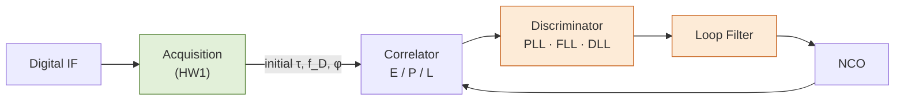

---

## 📂 Repository Structure

```text
AutoNavSys/
├── HW1/                         # Signal Acquisition
│   ├── MainHW1.m                # Run Tasks 1–5
│   ├── SourceCode/
│   │   ├── MainTask1~5.m
│   │   └── function/            # fctCA, fctACF, fctParallelAcq, fctSelection ...
│   ├── Data/                    # IncomingIF.mat (course-provided; excluded from Git)
│   └── Result/                  # sConvAcq.mat (precomputed conventional acquisition)
│
└── HW2/                         # Signal Tracking
    ├── MainHW2.m                # Run Tasks 1, 2, and 4
    ├── Data/                    # Task1.json through Task4.json (experiment and loop settings)
    ├── SourceCode/
    │   ├── MainTask1.m / MainTask2.m / MainTask4.m
    │   ├── GenerateTask4Data.m  # Generate 10 s of GPS IF samples
    │   └── function/
    │       ├── Code/            # C/A code generation · Sampling · Delay
    │       ├── Signal/          # IF signals · Replicas · AWGN
    │       ├── Correlator/      # ACF · CCF · E/P/L correlation
    │       ├── Acquisition/     # FFT acquisition · Thresholds · Detection
    │       ├── Tracking/        # fctDiscDLL/PLL/FLL · Loop · Tracking Step
    │       ├── Config/          # JSON configuration loading · Validation
    │       └── Output/          # Plotting · Result export
    └── Result/Task{1,2,4}/      # Generated figures (.png) and results (.csv/.json/.mat)
```

---

## 📡 HW#1 — Signal Acquisition

| Task | Description |
|:--:|:--|
| 1 | Generate GPS C/A codes and examine autocorrelation (ACF) and cross-correlation (CCF) |
| 2 | Analyze the time-domain waveform and PSD of the provided IF signal |
| 3 | Conventional time–frequency search; the current entry script loads precomputed `Result/sConvAcq.mat` |
| 4 | FFT–IFFT parallel code phase search (0.5-chip code bins, 250 Hz Doppler bins) |
| 5 | Test acquisition on a simulated received signal (PRN 13, 40 dB-Hz, 10 ms) |

---

## 🎯 HW#2 — Signal Tracking

### Task 1 · Discriminator Test

Use a fixed, noise-free received signal with a true code delay of 2 chips, Doppler of 0 Hz, and carrier phase of 0 cycles. Sweep **one replica parameter at a time** around these values to examine the **six correlator outputs (I<sub>E,P,L</sub>, Q<sub>E,P,L</sub>)** and the **PLL, FLL, and DLL S-curves**.

| Code delay | Doppler | Carrier phase |
|:--:|:--:|:--:|
| 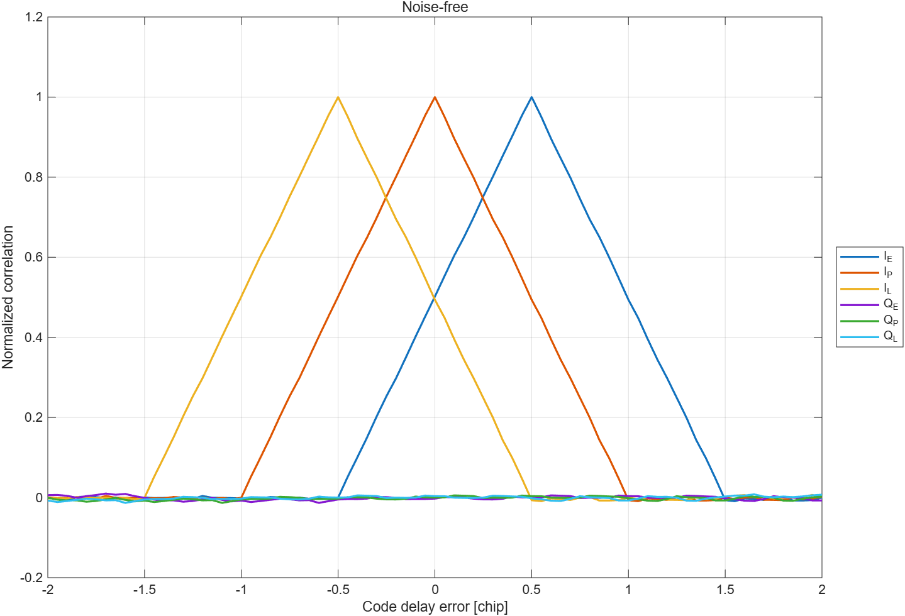 | 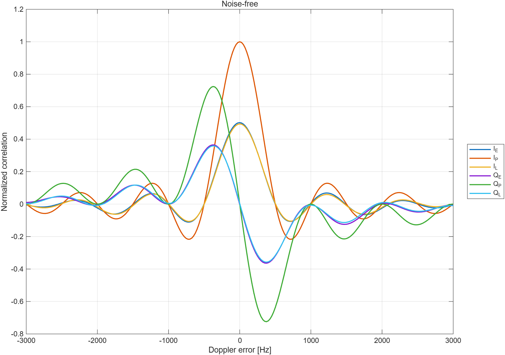 | 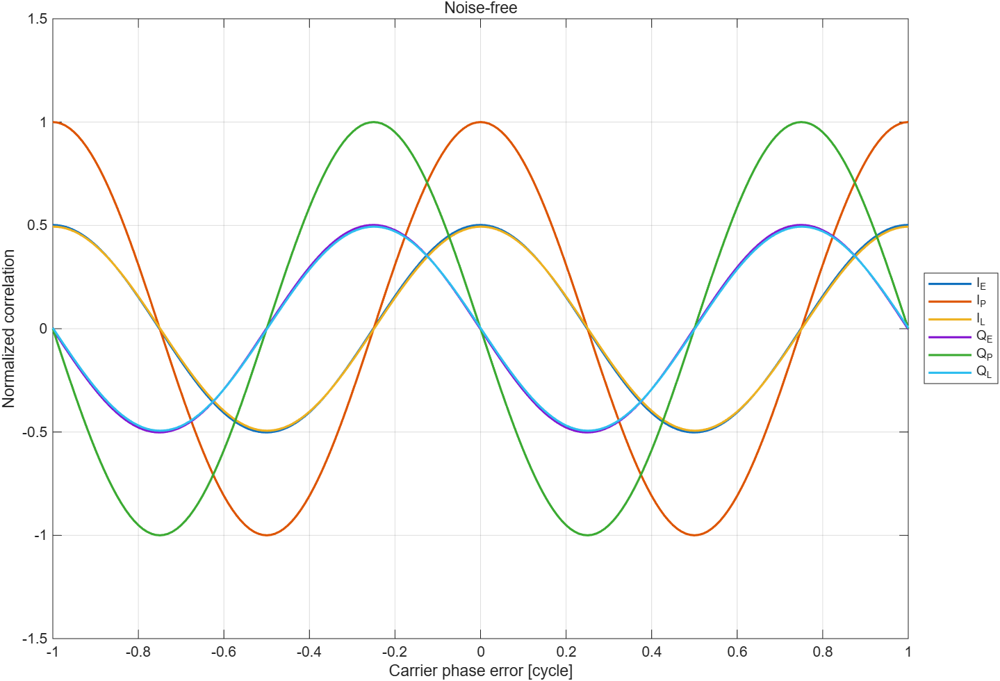 |
| 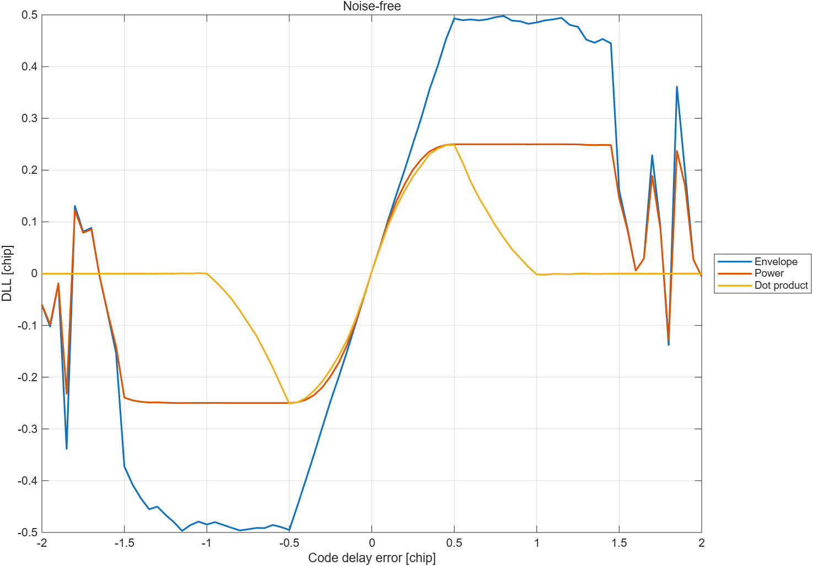 | 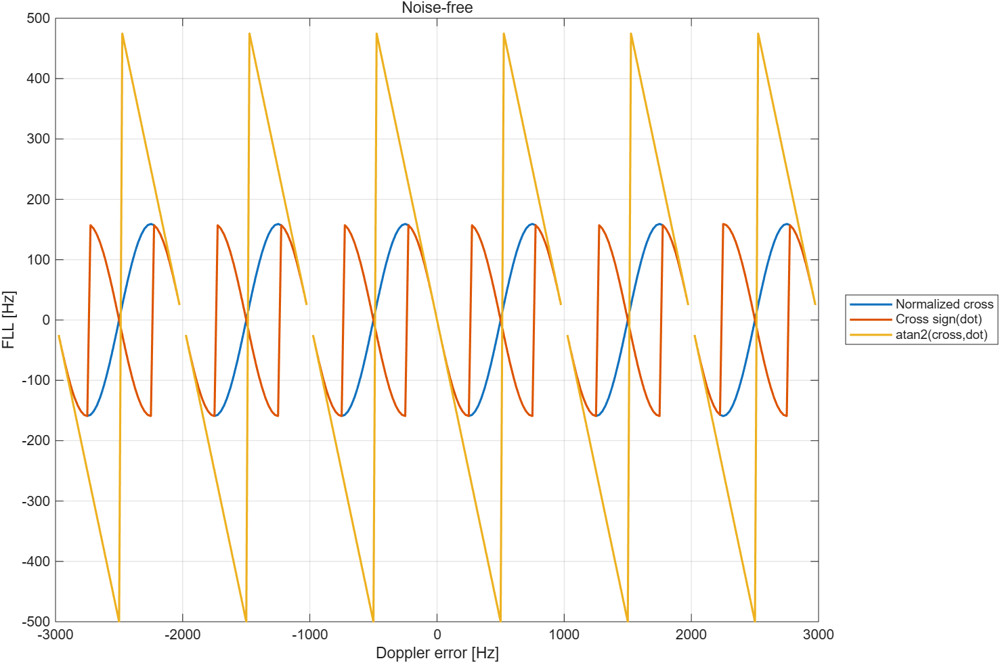 | 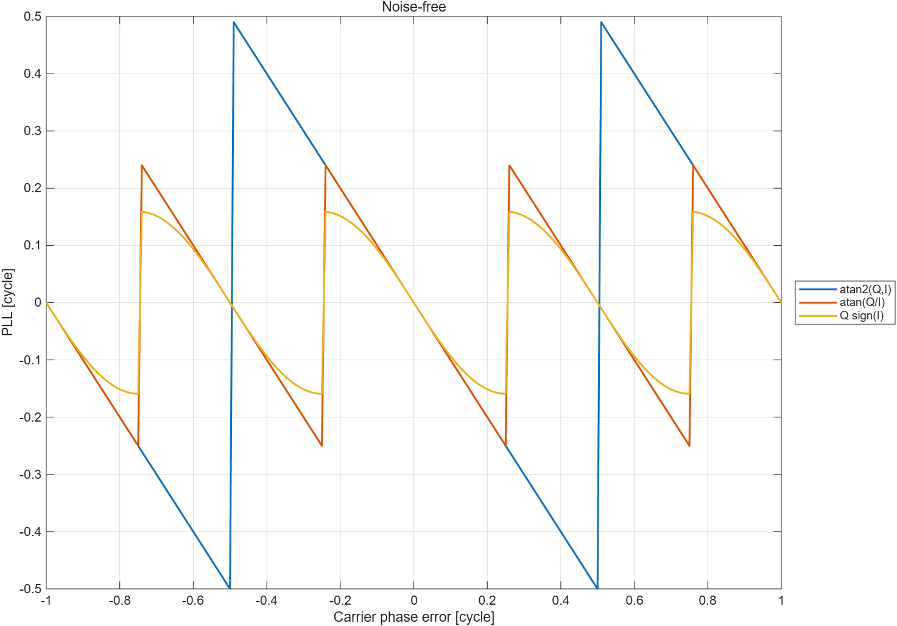 |
| **DLL** · Envelope / Power / Dot | **FLL** · cross / cross·sign(dot) / atan2 | **PLL** · atan2 / atan / Q·sign(I) |

### Task 2 · Derivation of Discriminators

For two noise-free prompt correlator outputs with unit amplitude:

$$\mathrm{cross}=I_{P1}Q_{P2}-I_{P2}Q_{P1}=\sin(\phi_2-\phi_1),\qquad \mathrm{dot}=I_{P1}I_{P2}+Q_{P1}Q_{P2}=\cos(\phi_2-\phi_1)$$

For amplitudes $A_1$ and $A_2$, both cross and dot include a factor of $A_1A_2$. The normalized cross implementation divides by this amplitude product.

For a triangular C/A autocorrelation model with E/P/L offsets of −0.5/0/+0.5 chips:

$$\frac{1}{2}\cdot\frac{E-L}{E+L}\approx\Delta\tau\quad(\lvert\Delta\tau\rvert < 0.5\ \text{chip})$$

The code uses the sign convention $\Delta\tau=\tau_{\mathrm{replica}}-\tau_{\mathrm{truth}}$. Sampled signals are also affected by discretization and noise.

| FLL identities | DLL identity |
|:--:|:--:|
| 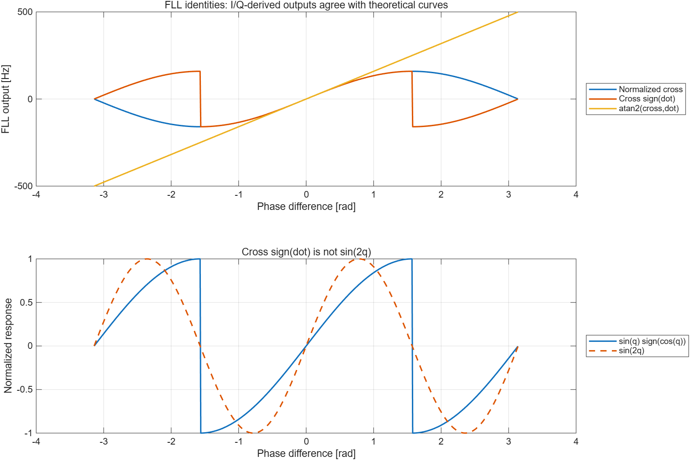 | 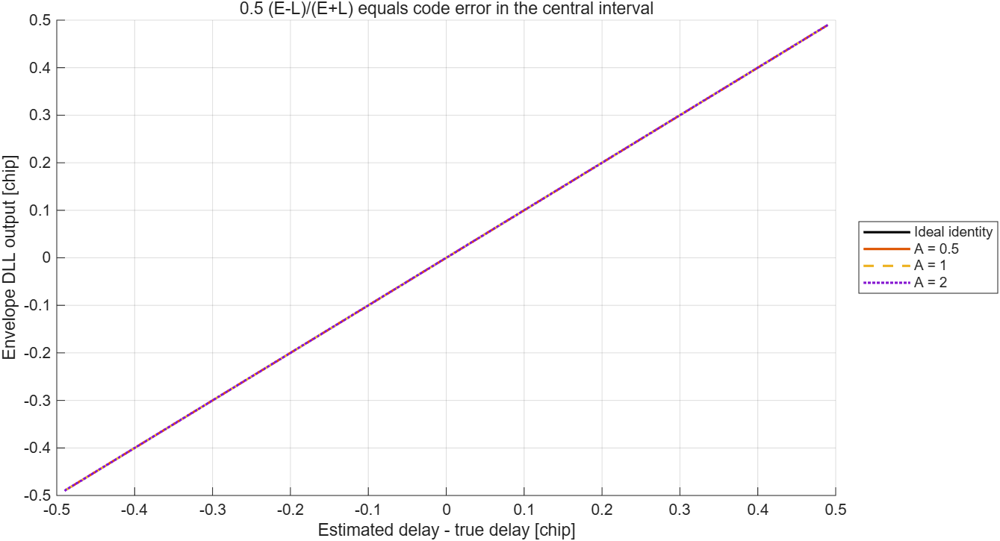 |
| **Amplitude effect** | **Noise effect** (Monte Carlo 10,000 trials) |
| 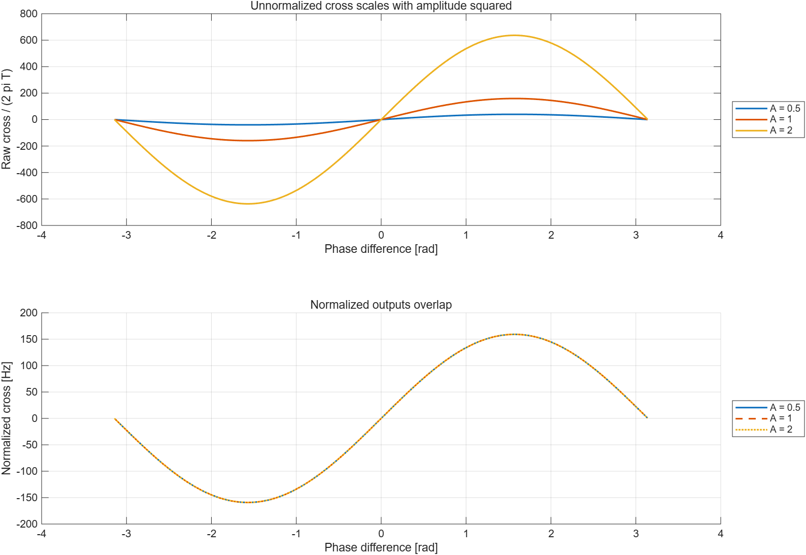 | 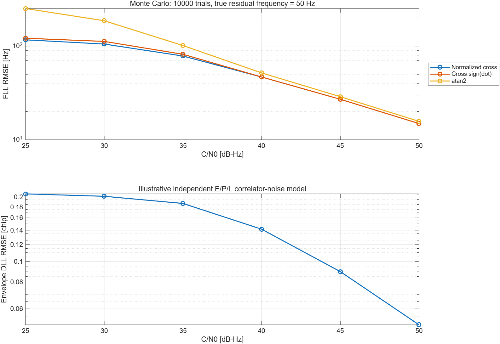 |

> 💡 For equal correlator amplitudes, the unnormalized cross scales with the amplitude squared. Amplitude-dependent gain and the noise effects of varying C/N₀ are examined separately.
> The Monte Carlo experiment uses complex AWGN after integration and approximates E/P/L noise as independent. In an IF receiver, the arms share samples, so their noise can be correlated.
> See [`NoiseStatistics.csv`](HW2/Result/Task2/NoiseStatistics.csv) for bias and RMSE at each C/N₀.

### Task 3 · Loop Filter Design

**Requirements** — Tolerate a maximum LOS jerk of **5 g/s** · No external navigation aiding · **Maintain PLL lock**

The **5 g/s design requirement** specifies the jerk the loop must tolerate. The Task 4 baseline uses a separate input scenario. Task 3 has no standalone entry script: its settings and calculated design values are stored in `HW2/Data/Task3.json` and used by Task 4.

**Architecture** — 2nd-order FLL-assisted 3rd-order PLL (Jaffe–Rechtin) + Carrier-aided 1st-order DLL

| Loop | Order | B<sub>n</sub> | ω<sub>0</sub> | Coefficients |
|:--|:--:|:--:|:--:|:--|
| PLL | 3 | 17 Hz | 20.4 rad/s | a<sub>3</sub> = 1.1, b<sub>3</sub> = 2.4 |
| FLL | 2 | 1.5 Hz | 2.835 rad/s | a<sub>2</sub> = 1.414 |
| DLL | 1 | 1 Hz | 4 s<sup>−1</sup> | carrier aiding 1/1540 |

<details>
<summary><b>📐 PLL Error Budget</b> (C/N0 = 30 dB-Hz, T = 1 ms)</summary>

| Term | Value |
|:--|--:|
| Thermal noise jitter | 9.15° |
| Vibration-induced jitter | 1.42° |
| Allan deviation jitter | 1.48° |
| Dynamic stress error (5 g/s) | 10.92° |
| **3σ + θ<sub>e</sub>** | **39.05° ≤ 45° ✅** |

The error budget assumes 30 dB-Hz for design analysis. Task 4 uses 40 dB-Hz; oscillator vibration and Allan noise are included in the analytical budget but are not injected into the simulated IF signal.

See [`HW2/Data/Task3.json`](HW2/Data/Task3.json) for design assumptions and calculated values.

</details>

### Task 4 · Loop Filter Test

| Scenario | Value |
|:--|:--|
| Signal | GPS L1 C/A, PRN 1, f<sub>s</sub> = 5.714 MHz, IF = 4.3 MHz |
| Duration | 10 s (T = 1 ms) |
| Dynamics | Doppler 1000 Hz + **10 Hz/s ramp**, **jerk = 0 g/s**, code delay evolves consistently with carrier Doppler |
| Navigation bit | Starts at +1 and **alternates between +1 and −1 every 20 ms** (deterministic test bits) |
| C/N0 | 40 dB-Hz |
| Initialization | Reuse HW#1 FFT acquisition (first 10 ms, 0.5-chip / 250 Hz bins); estimate initial carrier phase from the complex correlation |

After acquisition, process the remaining 9.99 s in 1 ms blocks. `fctTrackIF` repeatedly calls `fctTrackingStep`: E/P/L correlation → discriminators → loop filters → state update. The PLL uses a Costas discriminator, and the FLL handles the π ambiguity caused by data-bit reversals. Signal truth is used only for error evaluation after tracking.

“Parallel acquisition” refers to the FFT algorithm for searching code phases. The current MATLAB implementation runs sequentially and does not use `parfor` or a parallel pool.

| Acquisition | Prompt I/Q |
|:--:|:--:|
| 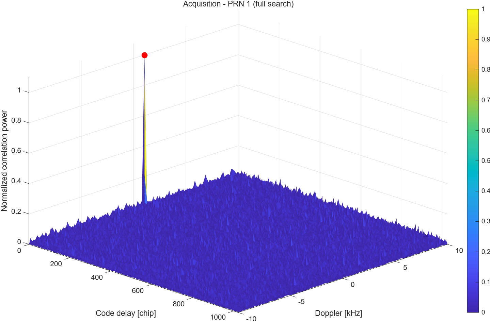 | 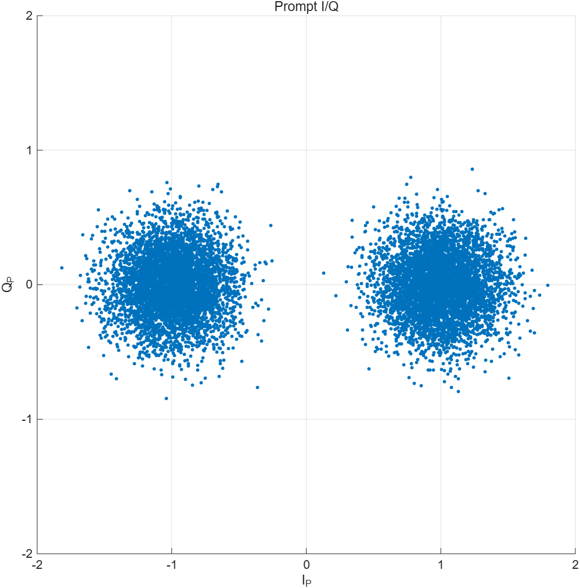 |

<details>
<summary><b>📊 Correlator · Discriminator · State · Error</b></summary>

| Correlators (zoom 7.0–7.1 s) | Discriminators |
|:--:|:--:|
| 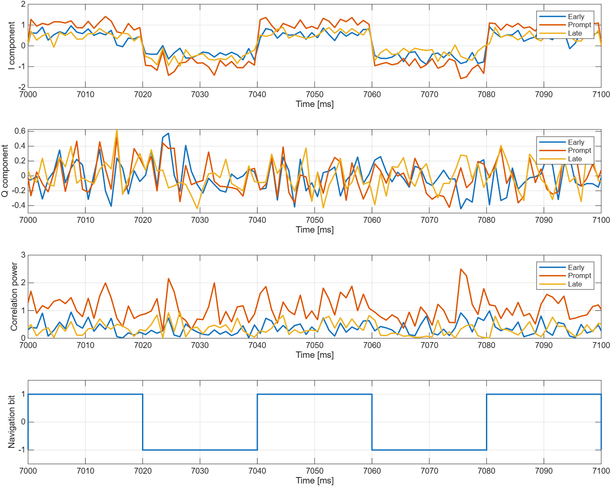 | 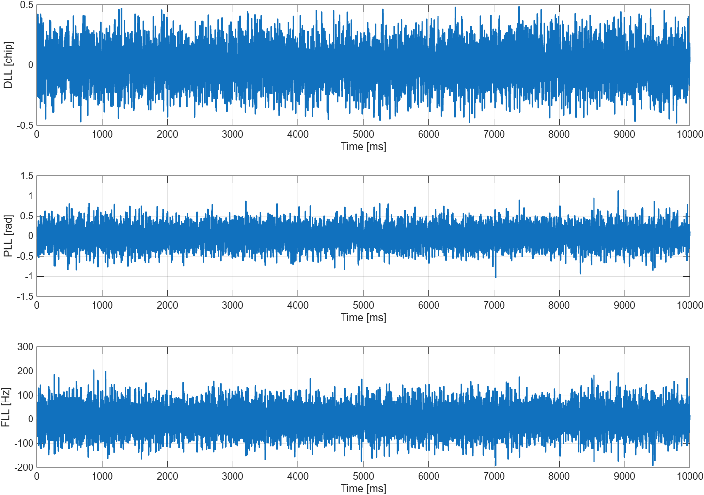 |
| **States** | **Tracking errors** |
| 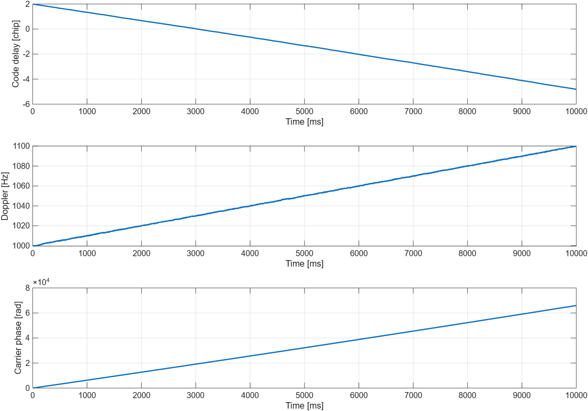 | 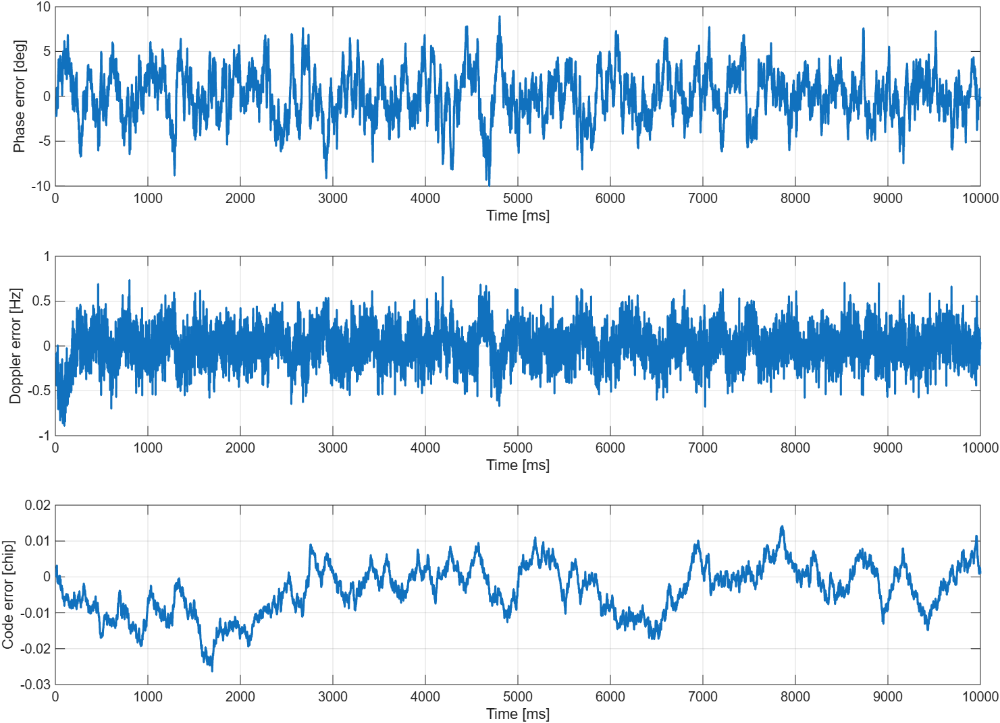 |

</details>

---

## ▶️ How to Run

```matlab
% Set the MATLAB current folder to the repository root (AutoNavSys/).
% HW#1 requires HW1/Data/IncomingIF.mat (course data; not in this repository).
% Task 3 loads HW1/Result/sConvAcq.mat.
run('HW1/MainHW1.m')

% HW#2: first generate the 10 s IF file for Task 4 (excluded due to its size).
run('HW2/SourceCode/GenerateTask4Data.m')   % → HW2/Data/GPS_IF_10s.mat
run('HW2/MainHW2.m')                         % Run Tasks 1, 2, and 4 → HW2/Result/
```

> ⚙️ HW2 experiment settings are managed in `HW2/Data/Task*.json`. After changing signal generation settings, rerun `GenerateTask4Data.m` to update the saved IF samples.
> If the precomputed HW1 Task 3 result is unavailable, enable the commented `fctConvenAcq` calculation in `HW1/SourceCode/MainTask3.m` and adjust the result-loading section.
> HW1 and HW2 contain functions with the same names. When switching between assignments, make sure the active MATLAB path resolves to the intended assignment’s functions.

---

## 📚 References

- E. D. Kaplan and C. J. Hegarty, *Understanding GPS: Principles and Applications*, 2nd ed., Artech House, 2006.
- J. H. Won, *Signal Tracking I & II*, Lecture Notes, ESPACE-TUM / Inha University.

<div align="center">

---

**Ji Won Lee** · M.S. Student, Department of Electrical and Computer Engineering, Inha University

</div>
